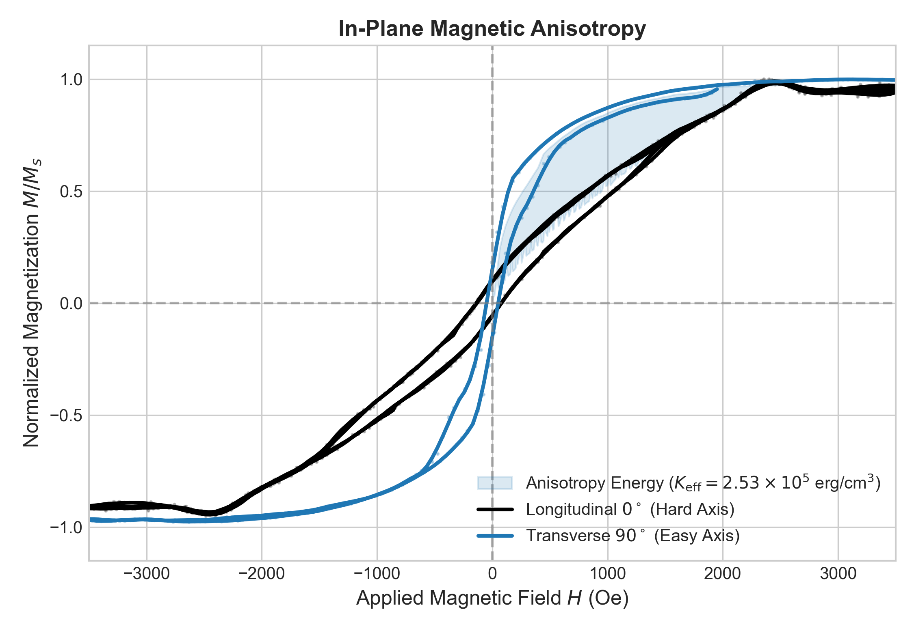
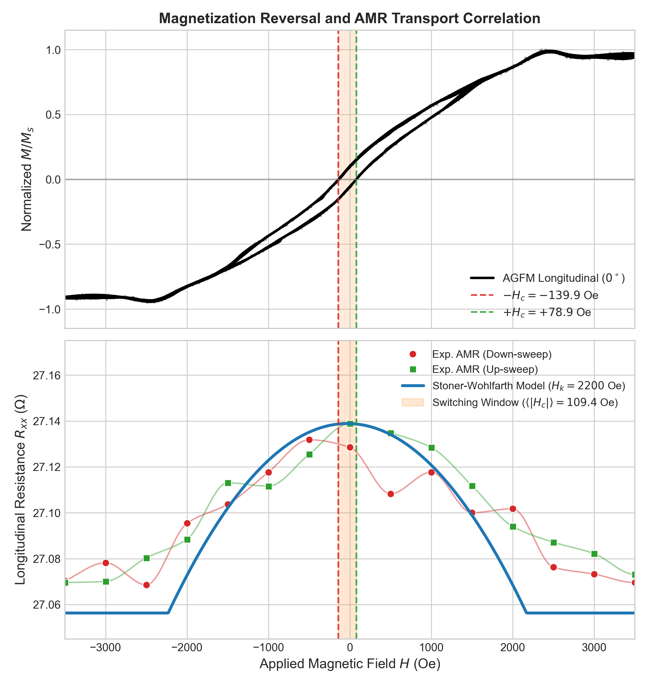

# Correlating Magnetization Reversal and Anisotropic Magnetoresistance in Ferromagnetic Thin Films

**Authors:** Joaquín Riquelme Ponce¹, Sheena Rasheed¹, Simón Oyarzún¹, Dhanalakshmi Radhalayam¹  
**Affiliation:** ¹Departamento de Física, Universidad de Santiago de Chile (USACH), Santiago, Chile  
**Conference:** XXV Simposio Chileno de Física (SOCHIFI 2026)

---

## Overview

This repository hosts the experimental datasets and Python data-processing pipeline for correlating in-plane magnetization reversal—measured via Alternating Gradient Force Magnetometry (**AGFM**)—with four-probe Anisotropic Magnetoresistance (**AMR**) transport in DC-sputtered $\text{Ni}(15\text{ nm})/\text{CuO}(5\text{ nm})$ bilayers grown on $\sim 2\text{ mm}$ glass substrates.

### Key Capabilities
1. **Automated Diamagnetic Background Subtraction:** Isolates the ferromagnetic thin-film response by fitting and subtracting the linear diamagnetic glass contribution ($\chi H$ for $|H| > 2400\text{ Oe}$) across positive and negative saturation branches.
2. **Magnetization Normalization & Thermodynamic Integration:** Normalizes experimental magnetic moments ($m(H) = M(H)/M_s \in [-1, 1]$) and integrates first-quadrant anisotropy areas ($K_{\text{eff}}$) and hysteresis loop dissipation ($E_{\text{diss}} = M_s \oint H \, dm$) via trapezoidal quadrature.
3. **Stoner-Wohlfarth Transport Reconstruction:** Anchors 4-probe longitudinal resistance $R_{xx}(H)$ to an analytical single-domain free-energy baseline:
   $$R_{xx}(H) = R_{\perp} + \Delta R \left[ 1 - \left(\frac{H - H_{eb}}{H_k}\right)^2 \right]$$

---

## Summary of Extracted Parameters

| Physical Parameter | Longitudinal ($0^\circ$) | Transverse ($90^\circ$) | Physical Meaning |
| :--- | :---: | :---: | :--- |
| **Switching Fields ($-H_c$ / $+H_c$)** | $-139.9$ / $+78.9\text{ Oe}$ | $-39.3$ / $+43.6\text{ Oe}$ | Exchange bias shift $H_{eb} = -30.5\text{ Oe}$ ($0^\circ$) |
| **Mean Coercivity ($\langle \|H_c\| \rangle$)** | $109.4\text{ Oe}$ | $41.5\text{ Oe}$ | Hysteretic domain-wall switching window |
| **Loop Dissipation ($E_{\text{diss}}$)** | $1.19 \times 10^{5}\text{ erg/cm}^3$ | $1.66 \times 10^{5}\text{ erg/cm}^3$ | Irreversible domain-wall pinning loss |
| **Uniaxial Anisotropy ($K_{\text{eff}}$)** | $2.53 \times 10^{5}\text{ erg/cm}^3$ | Easy Axis ($H_s < 800\text{ Oe}$) | Hard-axis saturation at $H_k \approx 2200\text{ Oe}$ |
| **AMR States ($R_{\perp}$ / $R_{\parallel}$)** | $27.056$ / $27.139\ \Omega$ | — | $\Delta R = 0.083\ \Omega$ ($\text{AMR Ratio} = 0.31\%$) |

---

## Figures

### 1. In-Plane Magnetic Anisotropy


### 2. Magnetization Reversal & AMR Transport Correlation


---

## Reproducing the Analysis

```bash
# Clone the repository
git clone [https://github.com/Raisuky/AMR-VSM-Correlation.git](https://github.com/Raisuky/AMR-VSM-Correlation.git)
cd AMR-VSM-Correlation

# Install dependencies
pip install -r requirements.txt

# Run the analysis and generate figures
python main_analysis.py
